# YiTech SwiftUI Kit

**YiTechSwiftUI** is a SwiftUI component library by Yi Tech Studio. It ships seven production components — queued toasts, an animated like control, a hierarchical category picker, a floating selection menu, a page indicator, and two popup systems — with no third-party dependencies and no brand tokens baked in.

- **Swift 6 package** — one product, `YiTechSwiftUI`, built with `swift-tools-version: 6.0`.
- **Host-based presentation** — `YTToast` and `YTPopup` install one overlay on the app root and own their presentation queue.
- **Call-site theming** — colors, fonts, corner radii, and transitions are supplied by the app through style types.
- **Previewed** — every component ships with an Xcode `#Preview` and a recorded preview in this document.

## Contents

- [Requirements](#requirements)
- [Installation](#installation)
- [Quick start](#quick-start)
- [Conventions](#conventions)
- [Components](#components)
  - [YTToast](#yttoast) — queued status toasts
  - [YTLike](#ytlike) — animated like control
  - [YTCategoryView](#ytcategoryview) — hierarchical category picker
  - [YTSelectionMenu](#ytselectionmenu) — floating selection menu
  - [YTPageIndicator](#ytpageindicator) — page indicator with presets
  - [YTPopup](#ytpopup) — queued alerts and sheets
  - [YTPopupContainer](#ytpopupcontainer) — view-scoped popup overlay
- [Development](#development)

## Requirements

| Platform | Minimum version |
| -------- | --------------- |
| iOS      | 17.0            |
| macOS    | 15.0            |
| tvOS     | 16.0            |
| watchOS  | 9.0             |

- Xcode 16 or newer, with a Swift 6.0 toolchain.
- `YTToast` and `YTPopup` require their host modifier on the app root before use.
- `YTLike`, `YTCategoryView`, `YTSelectionMenu`, `YTPageIndicator`, and `YTPopupContainer` have no setup requirement.

## Installation

### Xcode

1. Choose **File ▸ Add Package Dependencies…**.
2. Enter `https://github.com/sooYo/yitech-swift-ui-kit.git`.
3. Add the `YiTechSwiftUI` library product to the app target.

### Package.swift

```swift
dependencies: [
    .package(url: "https://github.com/sooYo/yitech-swift-ui-kit.git", branch: "main")
],
targets: [
    .target(
        name: "YourApp",
        dependencies: ["YiTechSwiftUI"]
    )
]
```

> No version tag is published yet, so this snippet tracks `main`. Switch to `.package(url: …, from: "0.1.0")` once a release tag exists.

Then import the module where the components are used:

```swift
import YiTechSwiftUI
```

## Quick start

Install both presentation hosts once, above any `TabView` or `NavigationStack`:

```swift
import SwiftUI
import YiTechSwiftUI

@main
struct DemoApp: App {
    var body: some Scene {
        WindowGroup {
            RootView()
                .yToastHost()
                .yPopupHost(alertStyle: .system, sheetStyle: .system)
        }
    }
}
```

Render components anywhere below that root:

```swift
struct RootView: View {
    @State private var page = 0
    @State private var like: YTLike.LikeValue = .unliked(animated: false)

    var body: some View {
        VStack(spacing: 24) {
            YTLike(initialCount: 128, likeValue: $like)

            YTPageIndicator(count: 5, index: $page, style: .extended)

            Button("Save") {
                YTToast.show(.success("Palette saved"))
            }
        }
        .padding()
    }
}
```

## Conventions

- **Actor isolation.** `YTToast` and `YTPopupHandle.dismiss()` are main-actor APIs. `YTPopup.alert(…)` and `YTPopup.sheet(…)` build their request on the calling thread and only touch the UI on the main actor, so a background producer may enqueue a popup directly.
- **One host per scene.** Install `.yToastHost()` and `.yPopupHost(…)` exactly once, above navigation containers, so overlays cover the whole window. The registry routes each request to the host that last became active.
- **Styles are injected, not owned.** The library ships neutral defaults (`YTToastStyle.classic`, `YTAlertStyle.system`, `YTSheetStyle.system`); the app injects its palette through the host or a per-request override.
- **Request identity.** `YTToastHandle.id` and `YTPopupHandle.id` identify one request. `YTPopupOptions.key` de-duplicates queued requests, and `YTToastHandle.update(_:duration:)` mutates a visible toast in place.
- **Accessibility.** Built-in controls expose labels and values (like count, like state, page position, expanded state). A custom panel style owns the accessibility of everything it draws.

## Components

Seven components, grouped by responsibility:

- **Presentation** — [`YTToast`](#yttoast) queues status toasts; [`YTPopup`](#ytpopup) queues alerts and bottom sheets. Both need a root host.
- **Scoped overlay** — [`YTPopupContainer`](#ytpopupcontainer) presents an overlay inside one view's subtree, with no queue and no host.
- **Controls** — [`YTLike`](#ytlike), [`YTCategoryView`](#ytcategoryview), [`YTSelectionMenu`](#ytselectionmenu), and [`YTPageIndicator`](#ytpageindicator) are plain views placed directly in a layout.

## YTToast

Queued toast presentation with semantic content and call-site rendering.

### Declaration

```swift
@MainActor
public enum YTToast

public enum YTToastContent
public struct YTToastStyle
public struct YTToastConfiguration
public struct YTToastHandle: Sendable
```

### Overview

`YTToast` shows short, transient status messages above the current screen. One host owns one queue, so a second toast waits its turn instead of stacking on a visible one, and a visible toast can be updated without being re-presented.

- Install the host once with `.yToastHost()`.
- Present with `YTToast.show(_:style:duration:)`, which returns a `YTToastHandle`.
- Update a toast in place with `YTToastHandle.update(_:duration:)`.
- Dismiss with `YTToastHandle.dismiss()` or `YTToast.dismiss()`.
- Replace the rendering with `YTToastStyle(configuration:contentBuilder:)`.

### Static API

```swift
@discardableResult
static func show(
    _ content: YTToastContent,
    style: YTToastStyle = .classic,
    duration: TimeInterval? = nil
) -> YTToastHandle

static func dismiss()
```

| Member | Discussion |
| ------ | ---------- |
| `show(_:style:duration:)` | Enqueues a toast on the active host and returns a handle for that request. |
| `dismiss()` | Dismisses the toast currently on screen, if any. |

### Content model

`YTToastContent` is the semantic payload. The classic renderer maps each case to a different layout.

| Case | Declaration | Rendering |
| ---- | ----------- | --------- |
| `message` | `.message(String)` | One-line HUD, no title/message split. |
| `success` | `.success(String, message: String? = nil, icon: Image? = nil)` | Checkmark icon, title, optional message. |
| `failure` | `.failure(String, message: String? = nil, icon: Image? = nil)` | Failure icon, title, optional message. |
| `loading` | `.loading(String, message: String? = nil, icon: Image? = nil)` | Indeterminate progress HUD with a title. |
| `progress` | `.progress(String, value: Double, message: String? = nil)` | Determinate bar. `value` is a fraction in `0...1` and is clamped by the renderer. |
| `action` | `.action(String, message: String, actionTitle: String, icon: Image? = nil, action: @MainActor () -> Void)` | Card with a trailing action button that runs `action`. |

### Handle

```swift
public let id: UUID

@MainActor public func dismiss()
@MainActor public func update(_ content: YTToastContent, duration: TimeInterval? = nil)
```

| Member | Discussion |
| ------ | ---------- |
| `id` | Request identifier used by the queue. |
| `dismiss()` | Removes this toast. A queued toast leaves without animating; repeated calls have no effect. |
| `update(_:duration:)` | Replaces the content without dismissing. The lifetime restarts from `duration`; `nil` keeps the current display time. Text cross-fades and the card animates to its new height. |

### Style

```swift
public init<Body: View>(
    configuration: YTToastConfiguration = .default,
    @ViewBuilder contentBuilder: @escaping @MainActor (YTToastContent) -> Body
)

public static var classic: YTToastStyle
public static func classic(configuration: YTToastConfiguration) -> YTToastStyle
```

| Member | Discussion |
| ------ | ---------- |
| `init(configuration:contentBuilder:)` | Builds a custom renderer. The builder owns how each content case is drawn; the host still owns queueing, timing, and transitions. |
| `classic` | The built-in presentation with default configuration. |
| `classic(configuration:)` | The built-in presentation with caller overrides. |

### Configuration

`YTToastConfiguration` holds the appearance and timing defaults. Its stored properties are mutable, so a call site can copy `.default` and change individual values.

| Property | Type | Default | Purpose |
| -------- | ---- | ------- | ------- |
| `text` | `Text` | `.init()` | Title font (13 pt medium) and color for card content. |
| `message` | `Message` | `.init()` | Message font (13 pt) and color (`.secondary`). |
| `background` | `Background` | `.init()` | Material, tint, border, shadow, and the short-form and long-form shapes. |
| `progress` | `Progress` | `.init()` | Progress bar tint (`.primary`). |
| `interaction` | `Interaction` | `.init()` | Whether the transparent host layer consumes taps outside the toast. |
| `animation` | `Animation` | `.init(…)` | Show and dismiss transition, curve, and duration. |
| `position` | `Position` | `.center` | `.center`, `.top`, or `.bottom`. |
| `duration` | `TimeInterval` | `2` | Default display time in seconds. |

Nested types:

| Type | Members |
| ---- | ------- |
| `YTToastConfiguration.Text` | `font`, `color` |
| `YTToastConfiguration.Message` | `font`, `color` |
| `YTToastConfiguration.Background` | `shape`, `longFormShape`, `material`, `color`, `borderColor`, `shadowColor` |
| `YTToastConfiguration.Progress` | `tint` |
| `YTToastConfiguration.Interaction` | `blocksBackgroundInteraction` (default `false`) |
| `YTToastConfiguration.Animation` | `show` and `dismiss`, each an `Animation.Set` of `transition`, `animation`, and `duration` |
| `YTToastConfiguration.Position` | `.center`, `.top`, `.bottom` |

`Background` defaults:

- `shape` — 14 pt continuous rounded rectangle.
- `longFormShape` — 20 pt continuous rounded rectangle, used for card content with a message.
- `material` — `.ultraThinMaterial`.
- `color` — white at 24% opacity.
- `borderColor` — white at 12% opacity.
- `shadowColor` — near-black at 16% opacity.

Default animation sets:

- **Show** — `.scale(scale: 0.92)` combined with `.opacity`, animated by `.spring(response: 0.28, dampingFraction: 0.86)`, recorded as `0.28` s.
- **Dismiss** — `.scale(scale: 0.96)` combined with `.opacity`, animated by `.easeOut(duration: 0.18)`, recorded as `0.18` s.

### Parameters

`YTToast.show(_:style:duration:)`

| Parameter | Type | Default | Discussion |
| --------- | ---- | ------- | ---------- |
| `content` | `YTToastContent` | — | Semantic payload to render. |
| `style` | `YTToastStyle` | `.classic` | Renderer and configuration for this toast only. |
| `duration` | `TimeInterval?` | `nil` | Display time in seconds. `nil` uses `style.configuration.duration`. `0` keeps the toast on screen until it is dismissed through its handle, replaced by another toast, or updated with a positive duration. |

**Returns** — a `YTToastHandle` for updating or dismissing the toast.

### Usage

Install the host once on the root view:

```swift
RootView()
    .yToastHost()
```

Show semantic content and read the handle:

```swift
YTToast.show(.success("Palette saved"))

let toast = YTToast.show(
    .progress("Syncing 12 palettes", value: 0.62, message: "Seven complete, five remaining."),
    duration: 0
)

// Later, on the main actor:
toast.update(.progress("Syncing 12 palettes", value: 0.8, message: "Ten complete, two remaining."))
toast.dismiss()
```

Chain a toast action that dismisses its own toast:

```swift
YTToast.show(
    .action(
        "Deleted Spring Garden",
        message: "Its 18 palettes were moved to All.",
        actionTitle: "Undo"
    ) {
        YTToast.dismiss()
        YTToast.show(.success("Deletion undone"))
    },
    duration: 4
)
```

Override the defaults without writing a renderer:

```swift
var configuration = YTToastConfiguration.default
configuration.position = .bottom
configuration.duration = 1.5
configuration.interaction.blocksBackgroundInteraction = true

YTToast.show(.message("Color copied"), style: .classic(configuration: configuration))
```

### Previews

**Short HUD** — a one-line `.message` toast (`Copied color #7F9A45`) that appears centered and leaves after the default two seconds.

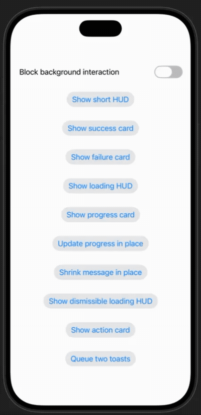

**Success card** — `.success` with a title and a long message; the card grows to the long-form shape next to a semantic checkmark.

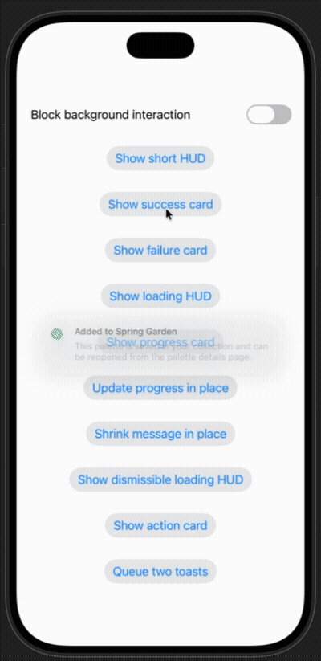

**Failure card** — `.failure` with a title and a message; the card keeps the same geometry with failure treatment and an error glyph.

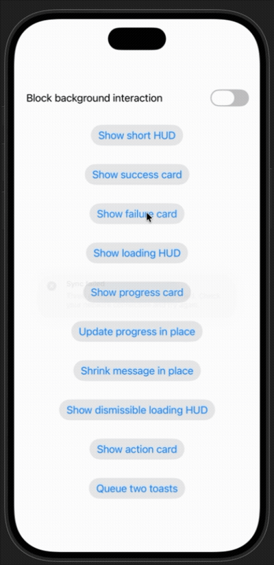

**Loading HUD** — `.loading` shows an indeterminate spinner with a title for the three seconds passed as `duration`.

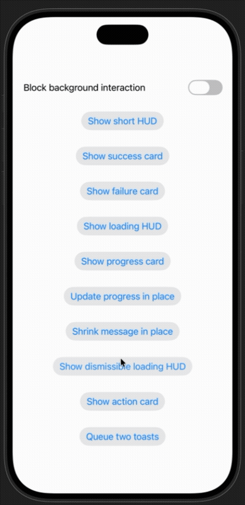

**Action card** — `.action` adds an Undo button; tapping it dismisses the toast and enqueues a success toast from the same closure.

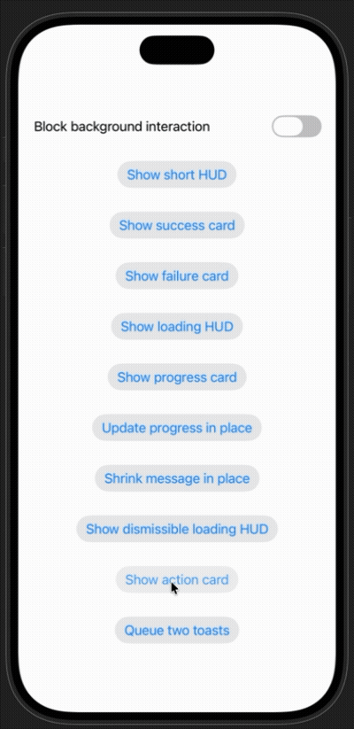

**Queue** — two toasts are shown back to back, and the second waits for the first to leave, so they never overlap.

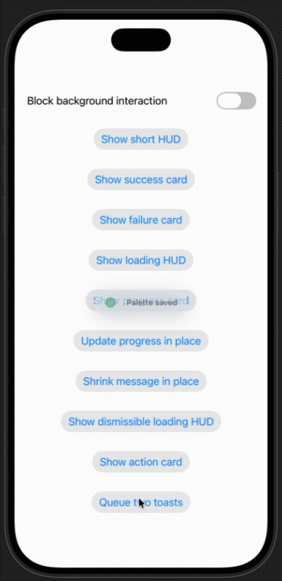

**In-place progress update** — `handle.update(_:)` moves the value from 62% to 80% and animates the card to the height its new message needs instead of flashing out and back in.

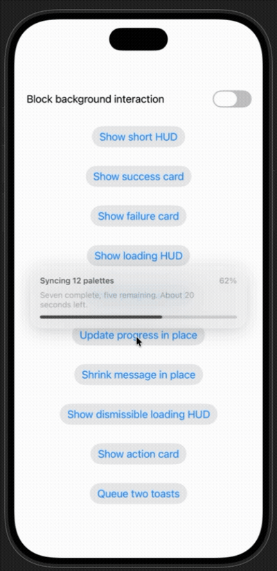

### See also

- [`YTPopup`](#ytpopup) — for blocking, actionable alerts and sheets instead of transient feedback.

## YTLike

Animated like control with selectable glyphs, two particle effects, and animation callbacks.

### Declaration

```swift
public struct YTLike: View
```

### Overview

`YTLike` is a single-tap toggle with a jelly animation on the glyph and an optional particle burst. It can own its state or mirror a parent-owned binding, and it reports animation progress to the caller.

- Choose the glyph with `Shape`: heart, star, or thumbs-up.
- Choose the particles with `Effect`: bloom ring or firework burst.
- Drive the control from parent state with `likeValue`.
- Observe `AnimationPhase` callbacks to coordinate external UI.
- Gate taps with `shouldStart` while another interaction is in flight.

### Nested types

| Type | Cases / members | Discussion |
| ---- | --------------- | ---------- |
| `LikeValue` | `.liked(animated: Bool)`, `.unliked(animated: Bool)` | `animated` describes the update, not whether the control is animating right now. |
| `LikeValue.isLiked` | `Bool` | Resolved selection state. |
| `LikeValue.isAnimated` | `Bool` | Whether the update should animate. |
| `Shape` | `.heart`, `.star`, `.thumbsUp` | `String` raw value, `CaseIterable`, `Sendable`. |
| `Effect` | `.bloom`, `.firework` | Ring of particles vs. radial burst. |
| `AnimationPhase` | `.started`, `.progress(Double)`, `.ended` | `progress` is a percentage in the closed range `0...100`. |

### Parameters

`YTLike.init(initialCount:likeValue:size:shape:strokeWidth:strokeColor:likedStrokeColor:fillColor:duration:burst:effect:showsCount:shouldStart:onAnimationPhaseChange:)`

| Parameter | Type | Default | Discussion |
| --------- | ---- | ------- | ---------- |
| `initialCount` | `Int` | `0` | Base count. Values below zero are clamped to `0`. |
| `likeValue` | `Binding<LikeValue>?` | `nil` | Bind when the parent owns state and animation intent. The control writes back `.liked(animated: true)` / `.unliked(animated: true)` on tap. |
| `size` | `CGFloat` | `44` | Glyph side length in points; clamped to at least `1`. |
| `shape` | `Shape` | `.heart` | Glyph to draw. |
| `strokeWidth` | `CGFloat` | `1.6` | Outline width; clamped to at least `0`. |
| `strokeColor` | `Color` | `.primary` | Outline color while unliked. |
| `likedStrokeColor` | `Color?` | `nil` | Outline color while liked; `nil` uses the default red `#E5484D`. |
| `fillColor` | `Color` | `#E5484D` | Fill color while liked. |
| `duration` | `TimeInterval` | `0.42` | Animation length in seconds; `0` applies the change immediately. |
| `burst` | `CGFloat` | `50` | Particle amount as a percentage, clamped to `0...100`. |
| `effect` | `Effect` | `.bloom` | Particle effect used while liking. |
| `showsCount` | `Bool` | `true` | Shows the numeric count beside the glyph. |
| `shouldStart` | `() -> Bool` | `{ true }` | Consulted before each tap; return `false` to ignore the tap. |
| `onAnimationPhaseChange` | `(AnimationPhase) -> Void` | `{ _ in }` | Called with `.started`, `.progress(0...100)`, and `.ended`. |

### Discussion

- **Displayed count.** The label renders `initialCount + (isLiked ? 1 : 0)`; the control does not persist counts, so the parent owns the stored total.
- **Binding contract.** With a `likeValue` binding, the parent can set `.unliked(animated: false)` to reset the control without an animation. A bound change is applied through `onChange`, and taps write the new value back to the binding.
- **Accessibility.** The control is a single element labelled `Like` or `Unlike`, with the count as its value and the `.isSelected` trait while liked.

### Usage

```swift
struct LikeRow: View {
    @State private var value: YTLike.LikeValue = .unliked(animated: false)
    @State private var isAnimating = false

    var body: some View {
        YTLike(
            initialCount: 1_284,
            likeValue: $value,
            size: 28,
            shape: .heart,
            duration: 0.5,
            burst: 60,
            effect: .bloom,
            showsCount: true,
            shouldStart: { !isAnimating },
            onAnimationPhaseChange: { phase in
                switch phase {
                case .started:
                    isAnimating = true
                case .progress(let percent):
                    print("animation at \(percent)%")
                case .ended:
                    isAnimating = false
                }
            }
        )
    }
}
```

### Previews

**Heart with bloom** — the default configuration: the heart fills in while a ring of particles blooms outward, then settles.

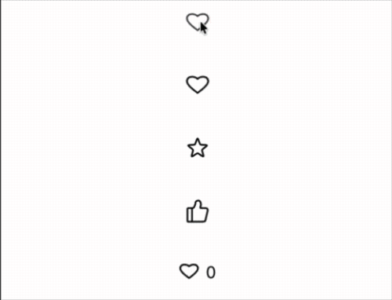

**Heart with count** — `showsCount: true` renders the total beside the heart, and the number steps with a numeric-text transition as it changes.

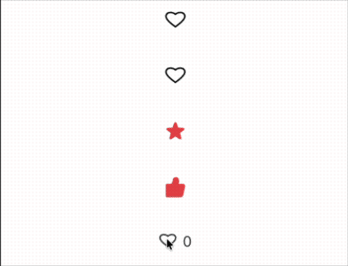

**Heart with firework** — `effect: .firework` replaces the bloom ring with a radial burst from the glyph.

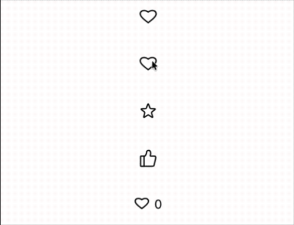

**Star** — `shape: .star` keeps the same timing, stroke, fill, and count behavior with the star glyph.

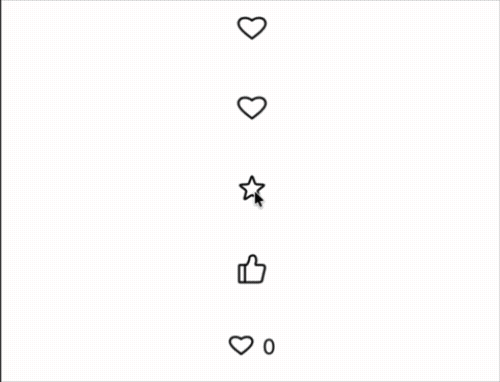

**Thumbs-up** — `shape: .thumbsUp` swaps the glyph again and offsets the heart-only vertical correction to zero.

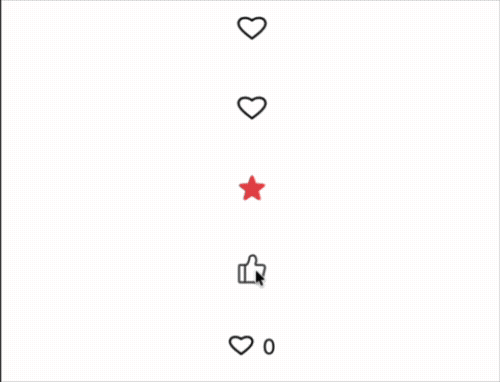

### See also

- [`YTPageIndicator`](#ytpageindicator) — for paged content that hosts like controls.

## YTCategoryView

Hierarchical category picker that navigates one level at a time.

### Declaration

```swift
public protocol YTCategoryItem: Identifiable where ID: Hashable

public struct YTCategoryView<Item: YTCategoryItem>: View
```

### Overview

`YTCategoryView` shows one level of a category tree as a horizontal chip row. Selecting an item that has children pushes the next level and leaves the parent as a path chip; tapping a path chip returns to that level.

- Conform the data model to `YTCategoryItem`.
- Bind `selectedID` to read and write the selection from outside.
- Supply `itemBuilder` to draw custom chip content.
- Tune spacing, colors, and font with `Style`.

### Data model

| Requirement | Type | Discussion |
| ----------- | ---- | ---------- |
| `id` | `ID: Hashable` | From `Identifiable`; must be unique across the whole tree, not just one level. |
| `name` | `String` | Chip label and path chip label. |
| `children` | `[Self]` | The next level. An empty array makes the item a leaf. |

### Style

| Property | Type | Default | Discussion |
| -------- | ---- | ------- | ---------- |
| `height` | `CGFloat` | `28` | Chip and path button height. |
| `itemSpacing` | `CGFloat` | `8` | Gap between chips in the current level. |
| `pathSpacing` | `CGFloat` | `4` | Gap between path chips and the level row. |
| `horizontalPadding` | `CGFloat` | `16` | Outer horizontal padding of the whole bar. |
| `selectedColor` | `Color` | `.primary` | Capsule fill for the selected chip and path chips. |
| `unselectedColor` | `Color` | `.secondary.opacity(0.12)` | Capsule fill for unselected chips. |
| `selectedTextColor` | `Color` | `.white` | Label color on filled capsules. |
| `textColor` | `Color` | `.primary` | Label color on unselected chips. |
| `font` | `Font` | `.system(size: 12, weight: .medium)` | Chip font; path chips always render at 12 pt and bold the current level. |

### Initializers

| Initializer | Discussion |
| ----------- | ---------- |
| `init(items:selectedID:initialSelectedID:style:backgroundColor:onSelect:)` | Default chip rendering. |
| `init(items:selectedID:initialSelectedID:style:backgroundColor:onSelect:itemBuilder:)` | Custom chip rendering through `(Item, isSelected: Bool, hasChildren: Bool) -> Content`. |

### Parameters

Both initializers accept:

| Parameter | Type | Default | Discussion |
| --------- | ---- | ------- | ---------- |
| `items` | `[Item]` | — | Root level of the tree. |
| `selectedID` | `Binding<Item.ID?>?` | `nil` | Two-way selection. The view keeps its own state when this is `nil`. |
| `initialSelectedID` | `Item.ID?` | `nil` | Selection used when no binding is supplied or the binding starts `nil`. |
| `style` | `Style` | `Style()` | Chip and path appearance. |
| `backgroundColor` | `Color` | `.clear` | Background of the whole bar. |
| `onSelect` | `((Item) -> Void)?` | `nil` | Called after a chip or path chip is chosen. |
| `itemBuilder` | `(Item, Bool, Bool) -> Content` | — | Custom chip content; receives the item, selection state, and whether it has children. |

### Discussion

- **Navigation.** Choosing a parent with children sets the selection and pushes a level; choosing a leaf sets the selection only.
- **Path chips.** The current path is drawn to the leading side. Tapping an ancestor truncates the path to that level and selects it.
- **Transition lock.** For 450 ms after a level change, further taps are ignored while the spring transition runs, so a double tap cannot skip a level.
- **Binding synchronization.** External changes to `selectedID` rebuild the path by searching the tree, and items added or removed are reconciled on the next update.

### Usage

```swift
struct Category: YTCategoryItem {
    let id: String
    let name: String
    let children: [Category]
}

struct CategoryBar: View {
    @State private var selectedID: String? = "warm"

    let categories: [Category]

    var body: some View {
        YTCategoryView(items: categories, selectedID: $selectedID) { item in
            print("selected \(item.name)")
        }
    }
}
```

Custom chip content:

```swift
YTCategoryView(
    items: categories,
    selectedID: $selectedID,
    onSelect: { _ in }
) { item, isSelected, hasChildren in
    HStack(spacing: 4) {
        Text(item.name)
        if hasChildren {
            Image(systemName: "chevron.down")
        }
    }
    .font(.system(size: 12, weight: isSelected ? .semibold : .medium))
    .padding(.horizontal, 10)
}
```

### Previews

**Level navigation** — after choosing `Palettes`, the ancestor becomes a path chip and the picker shows its children; choosing `Warm` moves the animated selection capsule to `Warm` while `Cool` stays selectable at the same level.

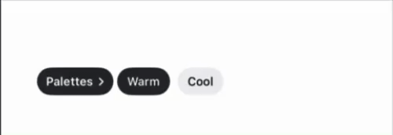

### See also

- [`YTSelectionMenu`](#ytselectionmenu) — for a flat, floating single-choice menu.

## YTSelectionMenu

A selection menu whose panel floats around its trigger without changing the trigger's layout size.

### Declaration

```swift
public struct YTSelectionMenu<Item: Identifiable & Hashable, Capsule: View, RowContent: View>: View

public struct YTSelectionMenuStyle
public struct YTSelectionMenuTriggerContext
```

### Overview

`YTSelectionMenu` starts as a capsule and expands into an options panel anchored above the trigger. The panel is presented outside the trigger's layout, so it can overflow the row without resizing it.

- Let the menu own the capsule: pass `capsule:` and the menu supplies the button and morphing background.
- Reuse an existing control: pass `trigger:` and call `context.open()` from its action.
- Draw the rows with `rowContent:`; the menu adds the panel, spacing, highlighter, and dismissal.
- Configure geometry and decoration with `YTSelectionMenuStyle`.
- The panel respects `accessibilityReduceMotion`, replacing the spring with a short ease-out.

### Initializers

| Initializer | Discussion |
| ----------- | ---------- |
| `init(items:selection:placeholder:style:label:capsule:rowContent:)` | Menu-owned capsule. `capsule` receives the resolved title; the menu wraps it in a button, applies the pressed scale, and animates the shared background. |
| `init(items:selection:placeholder:style:label:trigger:rowContent:)` | Call-site trigger. The trigger receives a `YTSelectionMenuTriggerContext`; call `open()` from its action so the menu owns presentation only. |

### Parameters

| Parameter | Type | Default | Discussion |
| --------- | ---- | ------- | ---------- |
| `items` | `[Item]` | — | Options shown as rows. |
| `selection` | `Binding<Item.ID?>` | — | Selected item. |
| `placeholder` | `String` | `"Select"` | Capsule title when the selection is `nil`. |
| `style` | `YTSelectionMenuStyle` | `.init()` | Geometry, panel, and highlighter. |
| `label` | `(Item) -> String` | — | Maps an item to its capsule and accessibility title. |
| `capsule` | `@ViewBuilder (String) -> Capsule` | — | Menu-owned collapsed content. |
| `trigger` | `@ViewBuilder (YTSelectionMenuTriggerContext) -> Capsule` | — | Existing interactive control that opens the menu. |
| `rowContent` | `@ViewBuilder (Item, Bool) -> RowContent` | — | Row content; the second parameter is the selection state. |

### Style

| Property | Type | Default | Discussion |
| -------- | ---- | ------- | ---------- |
| `panel` | `Panel` | `.init()` | Expanded panel background (`#212327`), corner radius `20`, optional shadow (`nil` by default). |
| `highlighter` | `Highlighter` | `.init()` | Selected-row decoration: `icon` (`checkmark`), `isVisible` (`true`), `backgroundColor` (white 8%). |
| `capsuleBackgroundColor` | `Color` | `#212327` | Background of the shared shape while collapsed. |
| `capsuleCornerRadius` | `Double` | `19` | Corner radius of the collapsed shape. |
| `rowCornerRadius` | `Double` | `10` | Corner radius of each option row. |
| `dimensions` | `Dimensions` | `.init()` | Capsule size (140 × 38) and row size (188 × 34). |

Supporting types:

- `YTSelectionMenuStyle.Panel` — `backgroundColor`, `cornerRadius`, `shadow` (`Panel.Shadow`: `color`, `radius`, `x`, `y`; `nil` removes it).
- `YTSelectionMenuStyle.Dimensions` — `capsule` and `row`, each a `Dimensions.Size` with `init(_ width: Double, _ height: Double)` and `init(size: Double)`.
- `YTSelectionMenuStyle.Highlighter` — `icon`, `isVisible`, `backgroundColor`.
- `YTSelectionMenuTriggerContext` — `title: String`, `isExpanded: Bool`, `open: () -> Void`.

### Discussion

- **Panel geometry.** The panel is `row.width + 24` wide and `row.height * count + 2 * (count - 1) + 24` tall, so the 12-point inset and 2-point row gap are constant.
- **Highlighter cost.** A visible highlighter reserves 32 points on the trailing edge of a row; hide it with `highlighter.isVisible = false` when rows need the full width.
- **Dismissal.** Tapping a row selects it and collapses the menu; tapping outside the panel collapses it without changing the selection.
- **Accessibility.** The capsule reports its title as the label and `Expanded` / `Collapsed` as the value.

### Usage

Menu-owned capsule:

```swift
struct Format: Identifiable, Hashable {
    let id: String
    let name: String
}

struct FormatMenu: View {
    @State private var selection: String? = "png"

    let formats: [Format]

    var body: some View {
        YTSelectionMenu(
            items: formats,
            selection: $selection,
            label: { $0.name },
            capsule: { title in
                HStack(spacing: 6) {
                    Text(title)
                    Image(systemName: "chevron.down")
                        .font(.system(size: 9, weight: .semibold))
                }
            },
            rowContent: { format, isSelected in
                Text(format.name)
                    .fontWeight(isSelected ? .semibold : .regular)
            }
        )
    }
}
```

Existing settings row as the trigger:

```swift
YTSelectionMenu(
    items: formats,
    selection: $selection,
    label: { $0.name },
    trigger: { context in
        Button(action: context.open) {
            SettingsRow(
                title: "Default Color Format",
                value: context.title
            )
        }
        .buttonStyle(.plain)
    },
    rowContent: { format, isSelected in
        Text(format.name)
    }
)
```

### Previews

**Default panel** — the collapsed capsule expands into the dark option panel; the selected row carries the highlighter and checkmark.

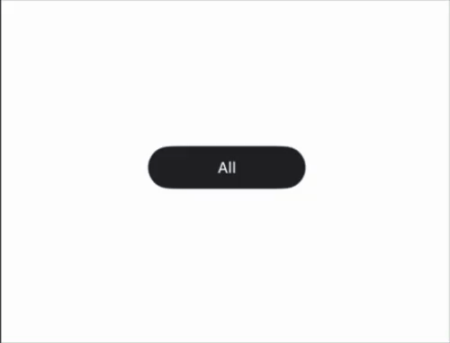

**Custom capsule** — the `capsule:` builder supplies a palette-icon capsule while the menu keeps the press feedback and the morphing background.

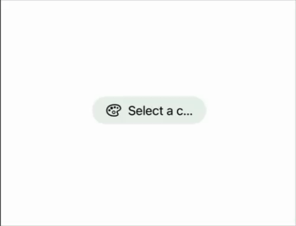

**Settings row expanded** — the `trigger:` initializer wraps the `Default Color Format` row; choosing `HSL` updates the row's trailing value, and the floating panel never resizes the row around it.

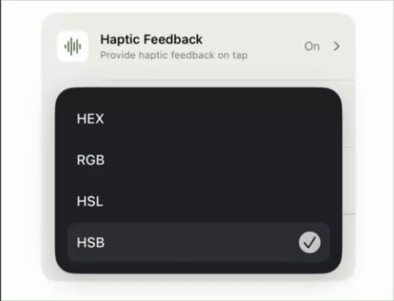

### See also

- [`YTCategoryView`](#ytcategoryview) — for nested, level-by-level category selection.

## YTPageIndicator

A compact page indicator with visual presets, timed advancement, and custom rendering.

### Declaration

```swift
public struct YTPageIndicator<Indicator: View>: View
```

### Overview

`YTPageIndicator` renders one mark per page and keeps the active index in sync with an optional binding. Three presets cover the common shapes, a timer preset shows per-page progress, and a builder hook replaces the marks entirely.

- Pick a preset with `Style`: `.extended`, `.dots`, `.roundedRectangle`, or `.timer(_:)`.
- Bind `index` to your pager; the indicator also works unbound with internal state.
- Enable timed advancement with `autoAdvance` and `interval`.
- Pause automatic playback after outside interaction with `interactionToken`.
- Replace the marks with the `indicatorBuilder` initializer.

### Style

| Case | Discussion |
| ---- | ---------- |
| `.extended` | Capsule marks; the active one expands to `expandedWidth`, or to three times `size.width` by default. |
| `.dots` | Equal circles; the active one is tinted. |
| `.roundedRectangle` | Equal rounded rectangles; set the corner with `cornerRadius`. |
| `.timer(_:)` | Progress tracks per page. `TimerConfiguration` controls whether the playback button is visible and lets the call site draw its own control. |

`TimerConfiguration`:

```swift
public init(visible: Bool = true)

public init<Control: View>(
    visible: Bool = true,
    @ViewBuilder playbackControl: @escaping (Bool, @escaping () -> Void) -> Control
)
```

| Initializer | Discussion |
| ----------- | ---------- |
| `init(visible:)` | Shows the built-in pause/play button unless `visible` is `false`. |
| `init(visible:playbackControl:)` | Replaces the button with call-site content; the closure receives `isPlaying` and a toggle action. |

### Parameters

| Parameter | Type | Default | Discussion |
| --------- | ---- | ------- | ---------- |
| `count` | `Int` | — | Number of pages; clamped to at least `0`. |
| `index` | `Binding<Int>?` | `nil` | Current page. Out-of-range values are clamped to `0...(count - 1)`. |
| `style` | `Style` | `.extended` | Preset to draw. |
| `size` | `CGSize` | `6 × 6` | Inactive mark size in points. |
| `expandedWidth` | `CGFloat?` | `nil` | Active mark width for `.extended` and `.timer`; defaults differ per style. |
| `spacing` | `CGFloat` | `8` | Gap between marks; timer styles use `12` to leave room for the control. |
| `cornerRadius` | `CGFloat?` | `nil` | Corner radius for `.roundedRectangle`; `nil` uses half the height. |
| `activeColor` | `Color?` | `nil` | Active tint; defaults to `.accentColor`, or white for timer styles. |
| `inactiveColor` | `Color?` | `nil` | Inactive tint; defaults to `.secondary.opacity(0.35)`, or white at 28% for timer styles. |
| `autoAdvance` | `Bool?` | `nil` | `nil` auto-advances only for timer styles; `false` disables advancement for any style. |
| `interval` | `TimeInterval` | `3` | Seconds per page; clamped to at least `0.1`. |
| `interactionToken` | `Int` | `0` | Change this value to signal outside interaction and pause playback. |
| `interactionPauseDuration` | `TimeInterval` | `60` | Seconds to wait after the last interaction before playback resumes; `0` disables the pause. |
| `onIndexChange` | `((Int) -> Void)?` | `nil` | Called whenever the page changes, including timer advancement. |
| `indicatorBuilder` | `@ViewBuilder (Int, Double, Bool) -> Indicator` | — | Custom mark. Receives the page index, the active page's progress in `0...1`, and the active flag. |

### Discussion

- **Progress.** Only the active mark receives a non-zero progress value, and only when timed advancement is enabled; other marks receive `0`.
- **Playback.** A timer style pauses when the user taps the playback control, and the indicator freezes its progress until playback resumes.
- **Interaction pause.** Bumping `interactionToken` (for example on a swipe) restarts the current page's remaining time and suspends advancement for `interactionPauseDuration`.
- **Binding sync.** When `index` leaves the valid range, the indicator writes the clamped value back.

### Usage

```swift
// Bound to a pager.
YTPageIndicator(count: 5, index: $page, style: .dots)

// Timer track with the built-in playback control.
YTPageIndicator(count: 6, index: $story, style: .timer(), interval: 6)

// Custom marks: index, progress in 0...1, isActive.
YTPageIndicator(count: 3, index: $page) { _, progress, isActive in
    RoundedRectangle(cornerRadius: 3)
        .fill(isActive ? AnyShapeStyle(.primary) : AnyShapeStyle(.secondary.opacity(0.3)))
        .frame(width: isActive ? 8 + 16 * progress : 8, height: 6)
}
```

### Previews

**Presets in one column** — the six built-in configurations: extended, dots, rounded rectangle, and timer tracks with the built-in pause control, without a control, and with a call-site control.

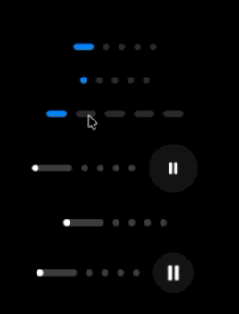

### See also

- [`YTLike`](#ytlike) — for the like control often placed alongside paged content.

## YTPopup

Queued alert and bottom-sheet presentation with one root host, shared queue, and call-site panel rendering.

### Declaration

```swift
public enum YTPopup

public struct YTPopupOptions: Sendable
public struct YTPopupHandle: Sendable
public struct YTPopupKind: Sendable

public struct YTAlertStyle: Sendable
public struct YTSheetStyle: Sendable
public struct YTAlertAction
public struct YTSheetAction
public struct YTSheetSubtitle: Sendable

public struct YTAlertPanelStyle
public struct YTSheetPanelStyle
```

### Overview

`YTPopup` routes alert and sheet requests through a single root queue. Alerts stack above any visible sheet, and sheets are presented one at a time in FIFO order.

- Install the host once with `.yPopupHost(alertStyle:sheetStyle:)`.
- Present directly with `YTPopup.alert(…)` and `YTPopup.sheet(…)`, or from state with `.ytAlert(…)` and `.ytSheet(…)`.
- Control dismissal, queue identity, appearance, scrim, and entry with `YTPopupOptions`.
- Theme the chrome once through `YTAlertStyle` / `YTSheetStyle`.
- Replace the whole panel per request with `YTAlertPanelStyle` / `YTSheetPanelStyle`.

### Host

```swift
func yPopupHost(
    alertStyle: YTAlertStyle = .system,
    sheetStyle: YTSheetStyle = .system
) -> some View
```

Installs the overlay and routes requests to it. Attach once, above tabs and navigation containers. While a popup is visible, underlying content stops receiving hit tests.

### Direct API

```swift
@discardableResult
static func alert(
    _ title: String,
    message: String? = nil,
    secondaryTitle: String? = nil,
    onCancel: @escaping () -> Void = {},
    primaryTitle: String,
    isDestructive: Bool = false,
    isDisabled: Bool = false,
    onConfirm: @escaping () -> Void = {},
    view: YTAlertPanelStyle = .standard,
    options: YTPopupOptions = .init(dismissible: false),
    onDismiss: (() -> Void)? = nil
) -> YTPopupHandle

@discardableResult
static func alert<Content: View>(
    _ title: String,
    message: String? = nil,
    secondary: YTAlertAction? = nil,
    primary: YTAlertAction,
    view: YTAlertPanelStyle = .standard,
    options: YTPopupOptions = .init(dismissible: false),
    onDismiss: (() -> Void)? = nil,
    @ViewBuilder content: @escaping () -> Content
) -> YTPopupHandle

@discardableResult
static func sheet<Content: View>(
    title: String,
    subtitle: YTSheetSubtitle? = nil,
    message: String? = nil,
    secondary: YTSheetAction? = nil,
    primary: YTSheetAction? = nil,
    onDismiss: (() -> Void)? = nil,
    view: YTSheetPanelStyle = .standard,
    options: YTPopupOptions = .init(),
    @ViewBuilder content: @escaping () -> Content
) -> YTPopupHandle

@discardableResult
static func sheet<Content: View>(
    options: YTPopupOptions = .init(),
    onDismiss: (() -> Void)? = nil,
    @ViewBuilder content: @escaping (@escaping () -> Void) -> Content
) -> YTPopupHandle
```

| Overload | Discussion |
| -------- | ---------- |
| `alert` — title and buttons | Title, optional message, and one or two titled actions. |
| `alert` — content slot | Same chrome plus a `content:` slot between the message and the buttons. |
| `sheet` — standard chrome | Title, optional subtitle and message, optional footer actions, and a body. |
| `sheet` — custom body | No chrome; the body receives a dismissal closure and owns the whole panel. |

### View modifiers

```swift
func ytAlert(
    _ title: String,
    isPresented: Binding<Bool>,
    message: String? = nil,
    secondaryTitle: String? = nil,
    onCancel: @escaping () -> Void = {},
    primaryTitle: String,
    isDestructive: Bool = false,
    isDisabled: Bool = false,
    onConfirm: @escaping () -> Void = {},
    view: YTAlertPanelStyle = .standard,
    options: YTPopupOptions = .init(dismissible: false)
) -> some View

func ytAlert<Content: View>(
    _ title: String,
    isPresented: Binding<Bool>,
    message: String? = nil,
    secondary: YTAlertAction? = nil,
    primary: YTAlertAction,
    view: YTAlertPanelStyle = .standard,
    options: YTPopupOptions = .init(dismissible: false),
    @ViewBuilder content: @escaping () -> Content
) -> some View

func ytSheet<Content: View>(
    isPresented: Binding<Bool>,
    title: String,
    subtitle: YTSheetSubtitle? = nil,
    message: String? = nil,
    secondary: YTSheetAction? = nil,
    primary: YTSheetAction? = nil,
    view: YTSheetPanelStyle = .standard,
    options: YTPopupOptions = .init(),
    @ViewBuilder content: @escaping () -> Content
) -> some View

func ytSheet<Content: View>(
    isPresented: Binding<Bool>,
    options: YTPopupOptions = .init(),
    @ViewBuilder content: @escaping (@escaping () -> Void) -> Content
) -> some View

func ytSheet<Item: Identifiable, Content: View>(
    item: Binding<Item?>,
    options: YTPopupOptions = .init(),
    @ViewBuilder content: @escaping (Item, @escaping () -> Void) -> Content
) -> some View
```

| Modifier | Discussion |
| -------- | ---------- |
| `ytAlert` — binding, two buttons | Presents when the binding becomes `true`; writes it back to `false` when the alert closes from inside. |
| `ytAlert` — binding, content slot | Content-slot variant of the same binding-driven alert. |
| `ytSheet` — binding, standard chrome | Standard sheet driven by a Boolean binding. |
| `ytSheet` — binding, custom body | Custom sheet driven by a Boolean binding; content receives a dismissal closure. |
| `ytSheet` — item-driven custom body | Presented while an `Identifiable` item is non-`nil`; content receives the item and a dismissal closure. Setting the item to `nil`, or changing its identity, closes the sheet. |

### Options

| Property | Type | Default | Discussion |
| -------- | ---- | ------- | ---------- |
| `dismissible` | `Bool` | `true` | Whether tapping the scrim dismisses the popup. The `alert` APIs default to `false`. |
| `key` | `String?` | `nil` | Queue identity, used to de-duplicate requests that are queued or visible. |
| `followsOwner` | `Bool` | `false` | Marks the request as owned by a view modifier. `.ytAlert` and `.ytSheet` set it automatically; direct calls leave it `false`. |
| `style` | `Style?` | `nil` | Per-request appearance override: `.alert(YTAlertStyle)` or `.sheet(YTSheetStyle)`. |
| `scrimColor` | `Color?` | `nil` | Overrides the default scrim tint for the popup's kind. |
| `entry` | `Entry` | `.automatic` | Alignment and entrance direction. |

`YTPopupOptions.Entry` cases:

- `.automatic` — kind default: a sheet slides from the bottom, an alert scales from the center.
- `.bottom`, `.top`, `.leading`, `.trailing` — align to that edge and slide in from it.
- `.scale` — centered, scale-in.
- `.fade` — centered, fade-in.

### Handle and kind

| Member | Declaration | Discussion |
| ------ | ----------- | ---------- |
| `id` | `let id: UUID` | Request identifier used by the queue. |
| `dismiss` | `func dismiss()` | Dismisses the request. Safe from any thread and safe to call repeatedly; a sheet still waiting in the queue is removed without animating. |

`YTPopupKind` distinguishes the two forms: `.alert` (a centered modal that stacks above any visible sheet) and `.sheet` (a bottom panel, presented one at a time).

### Alert appearance

`YTAlertStyle` is a set of resolved tokens; the library ships `.system` and holds no brand values.

| Token | Type | Default in `.system` |
| ----- | ---- | -------------------- |
| `surface` | `Color` | System surface |
| `titleColor` | `Color` | `.primary` |
| `messageColor` | `Color` | `.secondary` |
| `primarySurface` | `Color` | `.primary` |
| `primaryForeground` | `Color` | System surface |
| `secondarySurface` | `Color` | System fill |
| `secondaryForeground` | `Color` | `.primary` |
| `destructiveSurface` | `Color` | `.red` |
| `destructiveForeground` | `Color` | `.white` |
| `cornerRadius` | `CGFloat` | `24` |
| `actionCornerRadius` | `CGFloat` | `14` |
| `titleFontSize` | `CGFloat` | `17` |
| `messageFontSize` | `CGFloat` | `13` |
| `actionFontSize` | `CGFloat` | `15` |

### Sheet appearance

`YTSheetStyle` is the equivalent token set for sheets; it also ships `.system`.

| Token | Type | Default in `.system` |
| ----- | ---- | -------------------- |
| `surface` | `Color` | System surface |
| `cardSurface` | `Color` | System fill (icon buttons, secondary footer) |
| `borderColor` | `Color` | `.secondary.opacity(0.25)` |
| `titleColor` | `Color` | `.primary` |
| `subtitleColor` | `Color` | `.secondary` |
| `messageColor` | `Color` | `.secondary` |
| `iconColor` | `Color` | `.secondary` |
| `primarySurface` | `Color` | `.primary` |
| `primaryForeground` | `Color` | System surface |
| `secondaryForeground` | `Color` | `.primary` |
| `cornerRadius` | `CGFloat` | `28` |
| `buttonCornerRadius` | `CGFloat` | `16` |
| `titleFontSize` | `CGFloat` | `17` |
| `subtitleFontSize` | `CGFloat` | `11` |
| `messageFontSize` | `CGFloat` | `13` |
| `buttonFontSize` | `CGFloat` | `15` |

### Actions and subtitle

```swift
public struct YTAlertAction {
    public init(
        title: String,
        isDestructive: Bool = false,
        isDisabled: Bool = false,
        handler: @escaping () -> Void
    )
}

public struct YTSheetAction {
    public init(_ title: String, isEnabled: Bool = true, action: @escaping () -> Void)
}

public struct YTSheetSubtitle {
    public init(text: String, dotColor: Color? = nil)
}
```

| Type | Discussion |
| ---- | ---------- |
| `YTAlertAction` | One alert button. The queue closes the alert before running `handler`; `isDisabled` also suppresses the handler. |
| `YTSheetAction` | One sheet footer button. The queue does **not** close the sheet. |
| `YTSheetSubtitle` | Text under the sheet title with an optional leading color dot. |

### Panel styles

```swift
public struct YTAlertPanelStyle {
    public init<Body: View>(@ViewBuilder _ makeBody: @escaping @MainActor (YTAlertConfiguration) -> Body)
    public static var standard: YTAlertPanelStyle
}

public struct YTSheetPanelStyle {
    public init<Body: View>(@ViewBuilder _ makeBody: @escaping @MainActor (YTSheetConfiguration) -> Body)
    public static var standard: YTSheetPanelStyle
}
```

| Type | Discussion |
| ---- | ---------- |
| `YTAlertPanelStyle` | Replaces the whole alert UI for one request. The builder owns background, insets, and accessibility; the queue still owns the scrim, transition, and dismissal callbacks. |
| `YTSheetPanelStyle` | Replaces the whole sheet chrome for one request, including the drag handle and scrolling area. |

`YTAlertConfiguration` provides `title`, `message`, `secondary`, `primary`, `style`, `hasContent`, `content` (`AnyView`), and `dismiss`. `YTSheetConfiguration` provides `title`, `subtitle`, `message`, `secondary`, `primary`, `style`, `content`, and `dismiss`. Both are read-only snapshots built by the queue.

### Discussion

- **Alert ordering.** An alert always renders above a visible sheet, so a confirmation can interrupt a sheet without dismissing it.
- **Sheet queue.** Sheets are presented one at a time in FIFO order; enqueueing two sheets shows the second only after the first closes.
- **Alert actions.** Both buttons close the alert before their handler runs, so a handler can present a follow-up popup without racing the current one.
- **Sheet footer buttons.** `YTSheetAction` closures run without closing the sheet, which lets a footer button change page or present an alert while the sheet stays put. Close the sheet by resetting the presenting binding or calling the `dismiss` closure.
- **Content slot.** In the content-slot alert, the title and buttons remain the standard chrome; `configuration.hasContent` tells a custom panel style whether the slot is populated.
- **Ownership.** `.ytAlert` and `.ytSheet` set `followsOwner` on their options; direct `YTPopup` calls do not.

### Usage

Install the host once:

```swift
RootView()
    .yPopupHost(
        alertStyle: .system,
        sheetStyle: .system
    )
```

Direct alert and sheet:

```swift
YTPopup.alert(
    "Delete palette?",
    message: "This action cannot be undone.",
    secondaryTitle: "Cancel",
    primaryTitle: "Delete",
    isDestructive: true
)

YTPopup.sheet(
    title: "Queued sheet",
    message: "Only one sheet is visible at a time."
) {
    Text("Content comes from the call site.")
}
```

State-driven sheet, where a footer button can keep the sheet open:

```swift
.ytSheet(
    isPresented: $showsExport,
    title: "Export palette",
    subtitle: YTSheetSubtitle(text: "PNG · 2048 × 2048", dotColor: .orange),
    secondary: YTSheetAction("Cancel") {
        showsExport = false
    },
    primary: YTSheetAction("Export") {
        export()
    }
) {
    FormatPicker()
}
```

Item-driven sheet:

```swift
@State private var editing: Palette?

PaletteGrid()
    .ytSheet(item: $editing) { palette, dismiss in
        PaletteEditor(palette: palette, onClose: dismiss)
    }
```

Custom sheet with an entry override:

```swift
.ytSheet(
    isPresented: $showsFilters,
    options: .init(entry: .leading, dismissible: true)
) { dismiss in
    FilterSidebar(onClose: dismiss)
}
```

Custom alert panel for one request:

```swift
YTPopup.alert(
    "Custom alert view",
    message: "The whole panel comes from the call site.",
    secondaryTitle: "Cancel",
    primaryTitle: "Continue",
    view: YTAlertPanelStyle { configuration in
        VStack(spacing: 16) {
            Text(configuration.title)
                .font(.headline)

            if let message = configuration.message {
                Text(message)
                    .font(.subheadline)
                    .foregroundStyle(configuration.style.messageColor)
            }

            HStack(spacing: 12) {
                if let secondary = configuration.secondary {
                    Button(secondary.title, action: secondary.handler)
                }
                Button(configuration.primary.title, action: configuration.primary.handler)
            }
        }
        .padding(24)
        .frame(maxWidth: 300)
        .background(
            configuration.style.surface,
            in: RoundedRectangle(cornerRadius: configuration.style.cornerRadius)
        )
    }
)
```

### Previews

**Quick alert** — a destructive `ytAlert` confirmation (`Delete palette?`) that scales in above the screen content, with Cancel and Delete in the standard two-button layout.

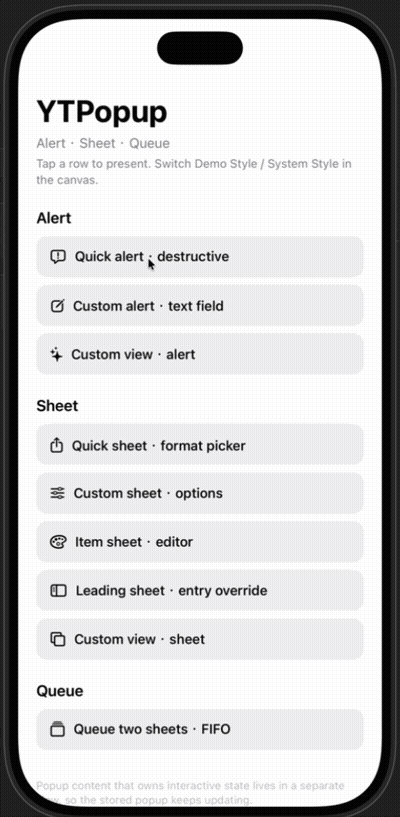

**Quick sheet** — `Export palette` with a subtitle dot and three format options; choosing a format updates the row, `Show alert above sheet` stacks an alert over the still-visible sheet, and Cancel/Export close it.

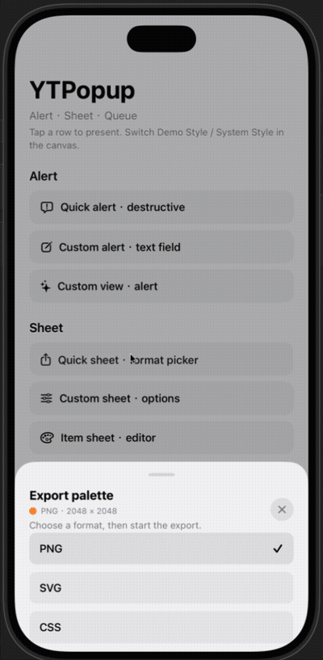

**Custom alert content** — the `content:` slot inserts a text field between the message and the buttons while the queue keeps the standard chrome and dismissal.

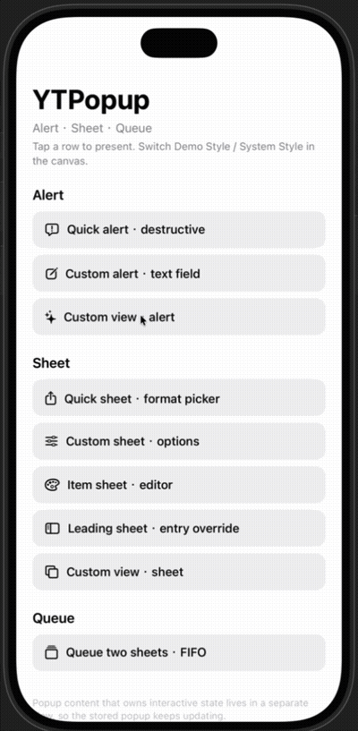

**Custom sheet content** — the standard sheet chrome with call-site rows: the sheet keeps the drag handle, subtitle dot, and footer actions, while the body owns its own layout.

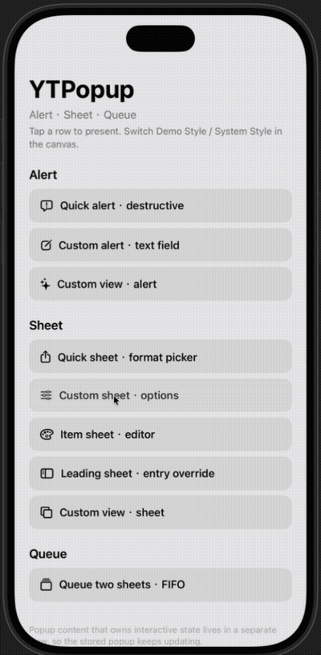

**Entry override** — `YTPopupOptions(entry: .leading)` slides a custom sheet in from the leading edge instead of the default bottom, and the call-site `dismiss` closure closes it.

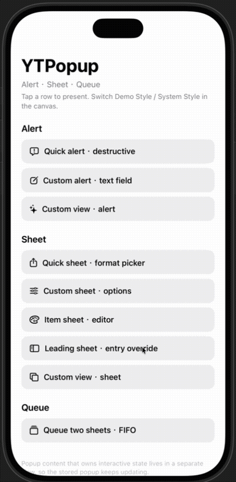

**FIFO sheet queue** — two sheets enqueued in one action appear one after the other; the second stays queued until the first is dismissed.

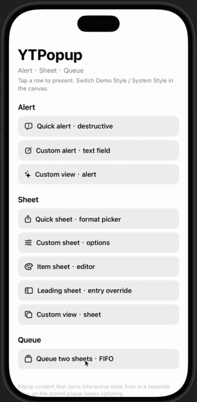

### See also

- [`YTPopupContainer`](#ytpopupcontainer) — for an overlay scoped to one view instead of the whole app.
- [`YTToast`](#yttoast) — for non-blocking feedback that does not need a scrim.

## YTPopupContainer

A view-scoped popup overlay for custom content, with configurable alignment, transition, barrier, and dismissal.

### Declaration

```swift
public struct YTPopupTransition
public struct YTPopupContainerModifier<PopupContent: View>: ViewModifier
public struct PopupItemModifier<Item: Identifiable, PopupContent: View>: ViewModifier
```

### Overview

`YTPopupContainer` is the lightweight alternative to `YTPopup`: it has no queue and no root host. The overlay lives on the view it modifies, so it is clipped to that view's layout and travels with it.

- Present from a Boolean with `.popupYT(isPresented:…)`.
- Present from an `Identifiable` item with `.popupYT(item:…)`.
- Choose the anchor with `alignment`; the default transition is derived from it.
- Add a barrier, blur, and tap-to-dismiss behavior around the content.
- Customize entrance and exit independently with `YTPopupTransition`.

### Modifiers

```swift
func popupYT<C: View>(
    isPresented: Binding<Bool>,
    alignment: Alignment = .center,
    transition: YTPopupTransition? = nil,
    blurRadius: CGFloat = 0,
    barrierColor: Color = .white.opacity(0.3),
    barrierDismissible: Bool = true,
    barrierTransition: YTPopupTransition = .fade,
    padding: EdgeInsets = EdgeInsets(top: 24, leading: 24, bottom: 24, trailing: 24),
    onDismiss: (() -> Void)? = nil,
    @ViewBuilder content: @escaping () -> C
) -> some View

func popupYT<Item: Identifiable, C: View>(
    item: Binding<Item?>,
    alignment: Alignment = .center,
    transition: YTPopupTransition? = nil,
    blurRadius: CGFloat = 0,
    barrierColor: Color = .white.opacity(0.3),
    barrierDismissible: Bool = true,
    barrierTransition: YTPopupTransition = .fade,
    padding: EdgeInsets = EdgeInsets(top: 24, leading: 24, bottom: 24, trailing: 24),
    onDismiss: (() -> Void)? = nil,
    @ViewBuilder content: @escaping (Item) -> C
) -> some View
```

| Modifier | Discussion |
| -------- | ---------- |
| `popupYT` — Boolean | Boolean-driven overlay. Setting the binding to `false` dismisses without calling `onDismiss`. |
| `popupYT` — item | Item-driven overlay; the content receives the non-`nil` item. Changing the item's identity animates the content swap. |

### Parameters

| Parameter | Type | Default | Discussion |
| --------- | ---- | ------- | ---------- |
| `isPresented` / `item` | `Binding<Bool>` / `Binding<Item?>` | — | Presentation state. |
| `alignment` | `Alignment` | `.center` | Where the content is anchored. |
| `transition` | `YTPopupTransition?` | `nil` | Entrance and exit style; `nil` derives `.slide(by: alignment)`. |
| `blurRadius` | `CGFloat` | `0` | Blur applied to the underlying content while presented. |
| `barrierColor` | `Color` | `.white.opacity(0.3)` | Scrim fill behind the content. |
| `barrierDismissible` | `Bool` | `true` | Whether tapping the scrim dismisses and calls `onDismiss`. |
| `barrierTransition` | `YTPopupTransition` | `.fade` | Entrance and exit of the scrim. |
| `padding` | `EdgeInsets` | `24` on every edge | Inset around the popup content. |
| `onDismiss` | `(() -> Void)?` | `nil` | Called only when the popup is dismissed internally (scrim tap), not when the binding is reset by the caller. |

### Transitions

| Factory | Discussion |
| ------- | ---------- |
| `slide(from:in:out:)` | Moves in from an edge combined with opacity; spring in, `easeIn` out. |
| `slideInAndFadeOut(from:in:out:)` | Moves in from an edge, fades out in place. |
| `scale(inScale:outScale:in:out:)` | Scales and fades in, then scales down and fades out. |
| `fade` | Opacity only, `easeOut` in and `easeIn` out. |
| `slide(by:)` | Maps the container `Alignment` to an edge; centered alignments fall back to `.scale()`. |

Each factory takes an insertion animation (default `.spring(response: 0.4, dampingFraction: 0.85)`) and a removal animation (default `.easeIn(duration: 0.2)`), except `fade`.

### Discussion

- **Hit testing.** While presented, the modified content stops receiving hit tests and the barrier blocks the area behind the popup.
- **Scope.** The overlay is attached to the modified view, so a popup presented from a row is sized and clipped by that row's context. Use `YTPopup` when the popup must cover the whole window.
- **No queue.** Two containers can be presented at once because each owns its own state; there is no global ordering to rely on.
- **Item identity.** In the item variant, changing the item keeps the overlay presented and animates to the new content.

### Usage

Boolean presentation:

```swift
struct EditorView: View {
    @State private var showsRename = false

    var body: some View {
        PaletteGrid()
            .popupYT(
                isPresented: $showsRename,
                alignment: .center,
                blurRadius: 4,
                barrierColor: .black.opacity(0.2),
                barrierDismissible: true
            ) {
                RenameCard()
            }
    }
}
```

Item presentation with an explicit transition:

```swift
@State private var editing: Palette?

PaletteGrid()
    .popupYT(
        item: $editing,
        alignment: .bottom,
        transition: .slideInAndFadeOut(from: .bottom),
        padding: EdgeInsets(top: 0, leading: 12, bottom: 0, trailing: 12)
    ) { palette in
        EditorSheet(palette: palette)
    }
```

### Previews

**Alert overlay** — a centered card over the current screen with a blurred background and a tappable scrim.

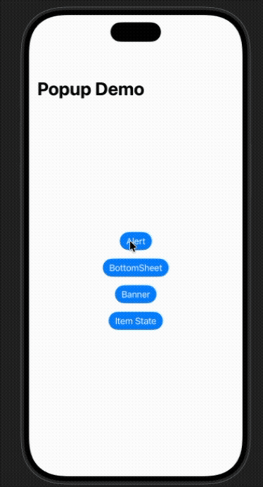

**Banner** — the same modifier anchored to `.top` slides a compact banner in from above the navigation bar.


**Bottom sheet** — anchored to `.bottom`, the content slides up from the bottom edge and leaves the scrim tappable.

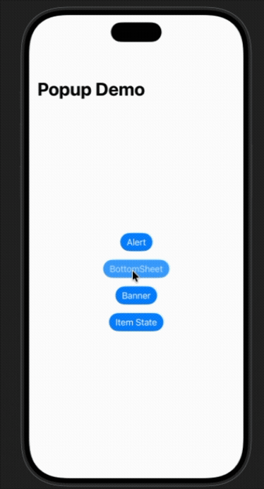

**Item state** — the `item:` overload presents while the item is non-`nil`, so the popup carries the model it edits instead of a separate Boolean.


### See also

- [`YTPopup`](#ytpopup) — for app-wide, queued alerts and sheets with standard chrome.

## Development

The package has no external dependencies. Build and test with the Swift 6 toolchain:

```bash
swift build
swift test
```

- **Sources** — `SwiftUI/Sources/YiTechSwiftUI/`
- **Tests** — `SwiftUI/Tests/YiTechSwiftUITests/`, covering toast queueing, handles, lifetimes, and bloom timing; the popup queue, registry, public API, and panel styles; `YTLike.LikeValue`; and selection-menu geometry.
- **Previews** — `#Preview` blocks beside each component. They need an Xcode preview host or an app target because the package has no executable target.
- **Preview recordings** — `README-assets/`, referenced above with repository-relative paths so they render on GitHub and in any local Markdown viewer.

---

© 2026 Yi Tech Studio. All rights reserved.
